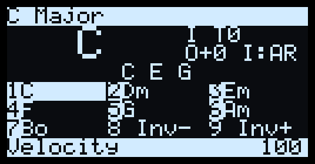
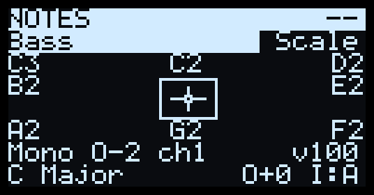
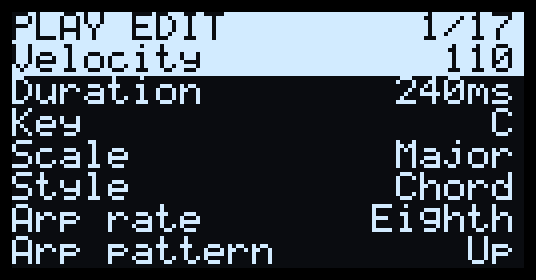
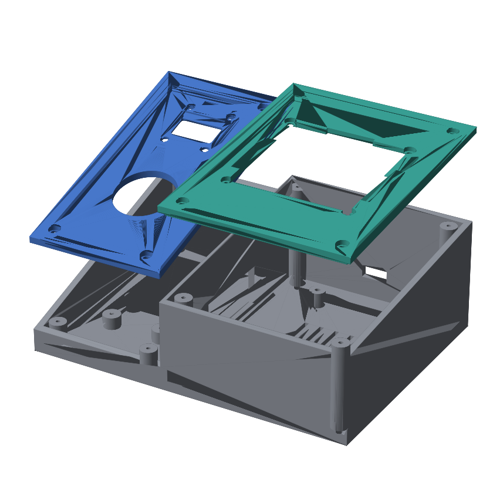
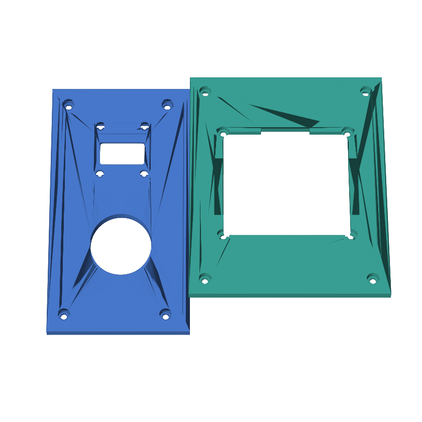

# o3Chords

[](https://github.com/trak3r-os/esp-o3Chords/actions/workflows/tests.yml)
[](https://github.com/trak3r-os/esp-o3Chords/actions/workflows/firmware.yml)
[](https://creativecommons.org/licenses/by-nc-sa/4.0/)
[](https://docs.espressif.com/projects/esp-idf/en/v5.5.3/)
[](https://www.espressif.com/en/products/socs/esp32-s3)
[](https://platformio.org)
[](https://en.cppreference.com/w/cpp/17)
[](docs/manual.md#connecting)

**A pocket chord instrument for the ESP32-S3.** Press a numbered key to play a
diatonic chord, shape it with a joystick, and edit settings on a 128×64 OLED
with a rotary encoder. It has no synth of its own: everything goes out as
standard MIDI over USB and Bluetooth LE at the same time, so it plays any DAW,
soft synth or hardware module.

```
 ┌───────────┐                                      ┌──────────────┐
 │ 4×4 keys  │──┐                               ┌──▶│ USB MIDI     │
 └───────────┘  │   ┌────────────────────────┐  │   │ (TinyUSB)    │
 ┌───────────┐  ├──▶│ Engine                 │  │   └──────────────┘
 │ Joystick  │──┤   │  chords · voice leading│──┤
 └───────────┘  │   │  strum · arp · clock   │  │   ┌──────────────┐
 ┌───────────┐  │   └────────────────────────┘  └──▶│ BLE MIDI     │
 │ Encoder + │──┘               │                   │ (NimBLE)     │
 │ CON / BAK │                  ▼                   └──────────────┘
 └───────────┘          ┌──────────────┐
                        │ OLED 128×64  │
                        └──────────────┘
```

| Play | Joystick (Bass preset) | Parameter list |
|:---:|:---:|:---:|
|  |  |  |

<sub>Rendered from the firmware's own framebuffer by the native test suite
(`test/tools/golden_to_png.py`).</sub>

---

## Features

| Area | What you get |
|------|--------------|
| **Chords** | Seven diatonic degrees in any of 12 keys, 22 scale and genre modes (Major, Dorian, Jazz, Neo Soul, Bossa Nova, Flamenco…) |
| **Voice leading** | Off, Smooth or Common: the device picks inversions so chords move as little as possible, always inside the octave you chose |
| **Voicings** | Close, Default, Drop 2, Drop 3, Open, Shell, Rootless and Guitar spreads; inversions automatic or set by hand |
| **Performance** | Chord, strum or arpeggio (7 patterns, up to 4 octaves); Shot, Hold or Repeat trigger; roll, swing and humanize |
| **Joystick** | Eight presets in three families: play notes (Lead, Bass, Drone), change the next chord (Colors, Discover, Voicings), or send continuous control (Bend, Macro) |
| **Clock** | Internal tempo (20–300 BPM) or external MIDI clock over USB or BLE |
| **MIDI** | USB MIDI device and BLE MIDI at once; USB host mode for MIDI input |
| **Interface** | OLED with three-level navigation (Play → Select → Edit), rotary encoder, CON and BAK buttons |
| **Persistence** | Settings saved to flash one second after the last edit; BLE pairings survive reboots |

---

## Quick start

1. **Build the hardware.** An ESP32-S3 DevKitC-1 plus a keypad, joystick,
   encoder, two buttons and an SSD1315 OLED. See [Hardware](#hardware).
2. **Flash the firmware.**
   ```bash
   pio run -e esp32s3 -t upload
   ```
3. **Connect.** Plug in USB-C, or pair **o3Chords** over Bluetooth. Select it as
   a MIDI input in your DAW and arm a track on channel 1.
4. **Play.** Keys **1–7** play chord degrees I–VII in C major. **A**/**B**
   change key, **C**/**D** change octave, **#** opens the settings.

The [user manual](docs/manual.md) covers everything else.

---

## Hardware

| Component | Part |
|-----------|------|
| MCU | ESP32-S3 DevKitC-1 |
| Display | SSD1315 128×64 OLED, I²C address 0x3C |
| Keypad | 4×4 matrix, 16 keys |
| Joystick | Two-axis analog stick (the push switch is not used) |
| Encoder | Rotary encoder with push switch |
| Buttons | Two momentary buttons: CON (confirm) and BAK (back) |

Pin map, from [`src/config/pins.h`](src/config/pins.h):

| Signal | GPIO |
|--------|------|
| I²C SDA / SCL (OLED) | 8 / 9 |
| Joystick X / Y (ADC1 CH0 / CH1) | 1 / 2 |
| Keypad rows | 10, 11, 12, 13 |
| Keypad columns | 15, 16, 17, 18 |
| Encoder A / B / push | 4 / 5 / 6 |
| CON button | 7 |
| BAK button | 14 |

> Power everything from 3.3 V. ESP32-S3 GPIOs are not 5 V tolerant.

A printable enclosure (CadQuery source and STL exports) is in
[`enclosure/`](enclosure/): a base with a USB-C opening, a left lid for the
joystick and OLED, and a right lid for the keypad.

| Exploded view | Lids, top view |
|:---:|:---:|
|  |  |

---

## Build and flash

Requires [PlatformIO](https://platformio.org). The platform is pinned to
`espressif32@6.13.0` (ESP-IDF 5.5.3); TinyUSB is vendored in `components/`, so
the build needs no component manager.

```bash
pio run -e esp32s3                     # build
pio run -e esp32s3 -t upload           # build and flash
pio device monitor -b 115200           # serial log

pio run -e esp32s3_keypadtest -t upload   # keypad wiring test, no app logic
```

If the board does not show up for flashing, hold key **D** (bottom right) while
powering on to enter USB download mode. Make sure the port you flash is the
o3Chords: other boards can enumerate as serial devices too.

Every push builds the firmware in CI; the binaries are attached to each run of
the **Firmware build** workflow.

---

## Native tests

The core of the firmware (engine, configuration, navigation, joystick logic and
the OLED renderer) builds and runs on the host. Hardware-facing code is
replaced by stubs, so the USB and BLE transports, the joystick ADC, the encoder
and the OLED panel itself are verified on the device.

```bash
./test/run_tests.sh                    # configure, build and run every suite

# or step by step
cmake -B test/build -S test
cmake --build test/build -j
ctest --test-dir test/build --output-on-failure
```

41 suites, about 680 tests. Screens are pinned pixel-for-pixel by golden
snapshots in [`test/golden/`](test/golden/).

`test/build/screen_dump` renders the real OLED screens in the terminal:

```bash
cd test/build
./screen_dump               # list scenarios
./screen_dump play_idle     # print a screen's pixels
./screen_dump play_idle --calls  # list its draw calls instead
./screen_dump --voicing     # notes a few progressions sound in each voice-leading mode
```

---

## Documentation

| Document | Content |
|----------|---------|
| [User manual](docs/manual.md) | Keypad, screens, joystick, voice leading, system menu, connecting, troubleshooting |
| [Joystick reference](docs/joystick-modes.md) | The eight presets, their families and parameters |
| [Parameter reference](docs/parameters.md) | Every setting: range, menu, effect |
| [Architecture](docs/architecture.md) | Data flow, state ownership, engine, MIDI and persistence |
| [Enclosure](enclosure/README.md) | 3D-printable case |

---

## Source layout

```
src/
├── main.cpp          hardware init and main loop
├── config/pins.h     GPIO map
├── drivers/          I²C, OLED, keypad, joystick, encoder, buttons, NVS storage
├── engine/           chords, voice leading, arpeggiator, performer, MIDI scheduler, clock
├── midi/             router → USB device, USB host and BLE sinks
├── app/              configuration, navigation, keypad and joystick handling
└── ui/               OLED renderer and display names
test/
├── unit/             one suite per file
├── stubs/            host stand-ins for ESP-IDF, FreeRTOS and NimBLE
├── golden/           reference framebuffers
└── tools/            screen_dump
components/           vendored TinyUSB and esp_tinyusb
enclosure/            CadQuery model and STL exports
```

---

## Status

The firmware builds and the native suite is green on every push. The USB, BLE,
encoder and joystick drivers can only be exercised on real hardware; if
something misbehaves, start with the manual's
[troubleshooting](docs/manual.md#troubleshooting) table and the serial log.

---

## License

© 2026 no3z. o3Chords (firmware, documentation and enclosure design) is
licensed under
[Creative Commons Attribution-NonCommercial-ShareAlike 4.0 International](https://creativecommons.org/licenses/by-nc-sa/4.0/)
(full text in [LICENSE](LICENSE)):

- **Attribution** — credit o3Chords / no3z and link to this licence.
- **NonCommercial** — no commercial use, including selling devices,
  kits or firmware built from this project.
- **ShareAlike** — if you share a modified version, it must use this same
  licence.

For commercial use, contact the author through GitHub.

The vendored TinyUSB (MIT) and esp_tinyusb (Apache-2.0) components in
`components/` keep their own licenses.
