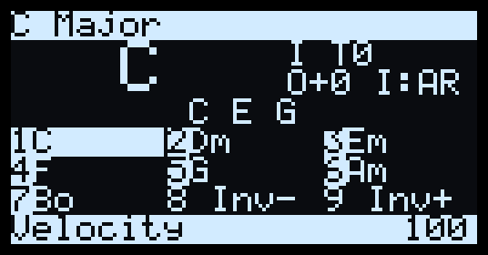
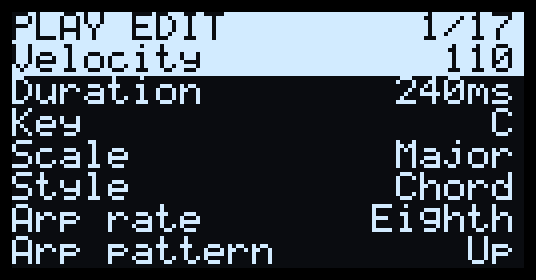
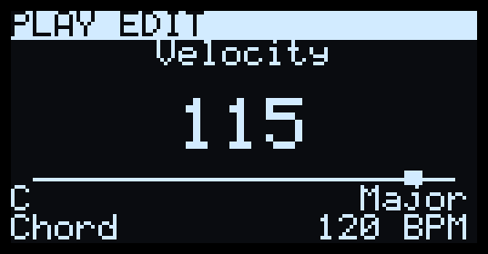
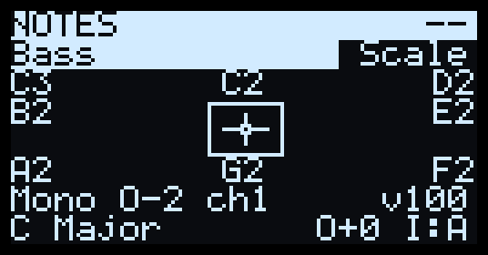
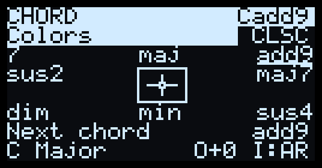
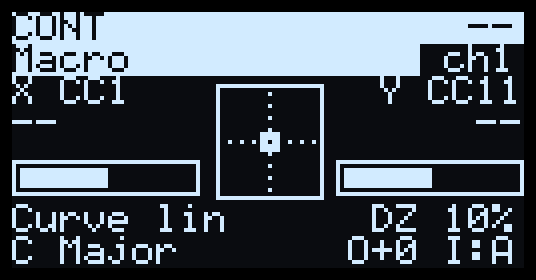

# o3Chords User Manual

o3Chords is a chord instrument. You press a numbered key to play a diatonic
chord, use the joystick to shape what it plays, and edit settings on a small
OLED screen with a rotary encoder. It makes no sound itself: everything goes
out as standard MIDI over USB and Bluetooth LE at the same time.

- [Quick start](#quick-start)
- [Front panel](#front-panel)
- [Keypad](#keypad)
- [Encoder and buttons](#encoder-and-buttons)
- [Screens](#screens)
- [Playing chords](#playing-chords)
- [Joystick](#joystick)
- [Voice leading and inversions](#voice-leading-and-inversions)
- [System menu](#system-menu)
- [Connecting](#connecting)
- [Saving and factory reset](#saving-and-factory-reset)
- [Troubleshooting](#troubleshooting)

---

## Quick start

1. Connect the device to a computer with a USB-C cable, or pair **o3Chords**
   over Bluetooth (see [Connecting](#connecting)).
2. In your DAW, enable o3Chords as a MIDI input and put an instrument on a
   track that listens to **channel 1**.
3. Press keys **1** to **7**: they play the seven chords of C major
   (C, Dm, Em, F, G, Am, B°).
4. Press **A** or **B** to change key, **C** or **D** to change octave.
5. Move the joystick: with the factory preset (**Lead**) it plays single scale
   notes on top of your chords.
6. Turn the encoder to change the value shown on the bottom line of the
   screen. Press it to move to the next value.

---

## Front panel

| Control | What it does |
|---------|--------------|
| 4×4 keypad | Chords, key, octave, inversion, menus, panic |
| Analog joystick | Plays notes, changes the next chord or sends continuous control, depending on the active preset |
| Rotary encoder | Turn to move or change values; press to step the cursor or confirm |
| CON button | Confirm. Does the same as pressing the encoder |
| BAK button | Back. On the Play screen it steps the cursor backwards |
| OLED, 128×64 | The screens described below |

---

## Keypad

```
   1    2    3    A
   4    5    6    B
   7    8    9    C
   *    0    #    D
```

| Key | Tap / press | Notes |
|-----|-------------|-------|
| **1 – 7** | Play chord degree I – VII of the current key | With Trigger set to Hold, the chord sounds while the key is down |
| **A** | Key up | One semitone (C → C# → D …) |
| **B** | Key down | Same step, opposite direction |
| **8** | Previous inversion | See [Voice leading and inversions](#voice-leading-and-inversions) |
| **9** | Next inversion | As above |
| **C** | Octave up | Voice leading carries on in the new register |
| **D** | Octave down | As above. **Held at power-on: enters USB download mode** |
| **0** | Switch the Play screen between the chord side and the joystick side | Ignored in menus |
| **\*** | Tap: back. **Hold (about 0.65 s): panic** | Panic silences every note and restarts voice leading |
| **#** | Tap: open the parameter list. **Hold: open System** | |

With **Keypad joy** enabled in System, keys **1, 2, 3, 4, 6 and 7** act as
joystick directions instead of playing chords, and key **5** returns the stick
to centre. Keys **8** and **9** keep their inversion job.

---

## Encoder and buttons

There are three navigation levels:

```
PLAY  ──#──▶  SELECT  ──press / CON──▶  EDIT
  ▲             │ ▲                       │
  └──── BAK ────┘ └──────── BAK ──────────┘
```

| Action | In PLAY | In SELECT | In EDIT |
|--------|---------|-----------|---------|
| Turn the encoder | Changes the value under the cursor | Moves through the list | Changes the value |
| Press the encoder, or CON | Moves the cursor forward | Opens the row for editing | Returns to the list |
| BAK | Moves the cursor backwards | Back to PLAY | Back to the list |

A long press on CON does the same as a short one. Every change applies at once.

---

## Screens

### Play



| Area | Shows |
|------|-------|
| Top bar | Key and scale |
| Large text | The chord being played (`READY` before the first one) |
| Right of it | Its degree; octave (`O+0`) and inversion (`I:AR`, see [inversions](#voice-leading-and-inversions)) |
| Middle line | The notes the chord sounds |
| Grid | The chord on each numbered key, plus the `8 Inv-` / `9 Inv+` shortcuts |
| Bottom bar | The value under the Play cursor |

The Play cursor walks through **Voicing, Voice leading, Roll, Velocity,
Trigger, Duration, Chord channel, Style, Scale and Key**. Press the encoder or
CON to step forward, BAK to step back, and turn to change the value. When a
joystick chord change is armed for the next chord, a `+quality` tag appears.

Press **0** to switch to the joystick side, which shows the active preset's own
display (see [Joystick](#joystick)). Its cursor reaches **Recipe** (the preset)
and, for some presets, one parameter of that preset.

### Select



A list of parameters with their values. A tap on **#** opens **PLAY EDIT**
(the chord parameters), or **JOYSTICK EDIT** when the Play screen is on the
joystick side. A long press on **#** opens **SYSTEM**. The header shows the
position in the list.

### Edit



One parameter and its value. Turn to change it; press, CON or BAK to go back
to the list. Key is edited on a circle-of-fifths wheel.

### Status words

| Word | Meaning |
|------|---------|
| `SAVE!` | Changes are waiting to be written to flash (about one second) |
| `REBOOT` | The USB role was changed and needs a restart to apply |
| `NO SAVE` | Settings cannot be saved; System → Reset clears this |

---

## Playing chords

These rows live in **PLAY EDIT** (tap **#**).

| Row | Values | What it does |
|-----|--------|--------------|
| Velocity | 1 – 127 | Note velocity of the chords |
| Duration | 20 – 4000 ms | Length of a chord with Trigger Shot, and the repeat period with Repeat |
| Key | C … B | Tonic. Also changed with keys A/B |
| Scale | 22 modes | Sets the chord quality of each degree (see below) |
| Style | Chord, Strum, Arp | All notes together, strummed, or arpeggiated |
| Arp rate | Quarter, Eighth, Sixteenth, Triplet | Arpeggio step, synced to the clock |
| Arp pattern | Up, Down, Up-Down, Down-Up, Up-Down Inclusive, Random, Played Order | Order of arpeggio notes |
| Arp octaves | 1 – 4 | Range the arpeggio covers |
| Strum feel | ms | Delay between the notes of a strum |
| Swing | 0 – 100 % | Delays every other step |
| Humanize | 0 – 40 ms | Random timing spread |
| Voicing | Close, Default, Drop2, Drop3, Open, Shell, Rootless, Guitar | How the chord's notes are spread |
| BPM | 20 – 300 | Internal tempo |
| Voice leading | Off, Smooth, Common | See [Voice leading](#voice-leading-and-inversions) |
| Roll | 0 – 60 ms | Delay between the voices of a chord |
| Roll direction | Up, Down, Out, In | Order of the roll |
| Trigger | Shot, Hold, Repeat | Shot plays for Duration; Hold sounds while the key is down; Repeat retriggers every Duration while held |

**Scales.** Seven modes (Major, Natural Minor, Harmonic Minor, Dorian,
Mixolydian, Sus2, Sevenths) and fifteen genre presets (Salsa, Bossa Nova,
Bachata, Reggaeton, Jazz, Neo Soul, Gospel, Lofi, Blues, Funk, R&B, Pop, Trap,
Motown, Flamenco). A genre preset keeps the major scale but gives each degree
the chord colours typical of that style, for example sevenths and ninths for
Jazz.

---

## Joystick

The joystick's behaviour depends on the **active preset**. The **Recipe** row
in JOYSTICK EDIT (or on the joystick side of the Play screen) walks through the
eight presets:

| Family | Preset | What the stick does |
|--------|--------|---------------------|
| Notes | **Lead** | Plays scale notes on the joystick channel. Walking the stick further sends higher velocity |
| Notes | **Bass** | Plays low, single scale notes from a clock-face layout |
| Notes | **Drone** | Each direction latches a sustained chord; the same direction again releases it |
| Chord | **Colors** | Arms a new chord quality for the next numbered key. The same direction again disarms it |
| Chord | **Discover** | Arms a suggested chord for the next key. The same direction again disarms it |
| Chord | **Voicings** | Sets the voicing spread of the chords |
| Continuous | **Bend** | X sends pitch bend snapped to chord tones; Y sends vibrato |
| Continuous | **Macro** | X and Y send MIDI CC values (CC 1 and CC 11 by default) or aftertouch |

| Notes (Bass) | Chord (Colors) | Continuous (Macro) |
|:---:|:---:|:---:|
|  |  |  |

- Chord-family directions never play a note themselves: they only change what
  the next numbered key plays. Moving the stick while a chord is held does not
  release it.
- Continuous presets follow the stick's position. Nothing is sent inside the
  **Deadzone** (10 % by default). The response **Curve** can be Linear, Exp or
  Log.
- **Invert X** and **Invert Y** in System flip the axes.
- If the stick sends values when released, run **System → Calibrate joy** with
  the stick untouched.

Every preset parameter is listed in the [joystick reference](joystick-modes.md).

---

## Voice leading and inversions

A chord has a **register** (set by the octave), an **inversion** (which chord
tone is lowest) and a **voicing**. Voice leading chooses the inversion and
octave placement for you so the notes move as little as possible from one
chord to the next.

| Mode | Behaviour |
|------|-----------|
| **Off** | Chords sound as written, in root position |
| **Smooth** | Each chord takes the inversion nearest the previous one |
| **Common** | Like Smooth, but notes shared with the previous chord stay where they are. The difference is clearest on four-note and larger chords |

Example, I – IV – V – I in C with Smooth:

```
C E G  →  C F A  →  B D G  →  C E G
```

**Inversions by hand.** Keys **8** and **9** cycle the inversion through
`AUTO → ROOT → 1ST → 2ND → AUTO`. AUTO lets voice leading choose; the other
steps fix it. The screen shows `I:A` (automatic, nothing played yet), `I:AR`,
`I:A1`, `I:A2` (automatic, and what it chose) or `I:R`, `I:1`, `I:2` (set by
hand). With voice leading Off, AUTO is skipped.

**The octave always wins.** Voice leading only picks between placements whose
bass is within a few semitones of the key's tonic in the octave you chose, so a
progression never drifts up or down. Changing octave or inversion while a chord
is held re-voices it at once.

---

## System menu

Long press **#**. Rows, top to bottom:

| Row | Use |
|-----|-----|
| Chord ch | MIDI channel for chords (1 – 16) |
| Keypad joy | Use keys 1 – 7 as joystick directions (see [Keypad](#keypad)) |
| Clock | Internal, Auto or External MIDI clock |
| USB role | Off, Device or Host. Takes effect after a reboot |
| BLE | Bluetooth MIDI on or off |
| Invert X / Invert Y | Flip the joystick's axes |
| Panic | All notes off. Also a long press on `*` |
| Reset | Restore factory defaults |
| Reboot | Restart the device |
| DFU | Restart into USB download mode, for flashing |
| Info | Firmware version and credits |
| Calibrate joy | Measure the joystick's centre |

Reset, Reboot, DFU and Panic ask for confirmation: turn to **Confirm** and
press CON. BAK cancels. The bottom line shows the USB and BLE link state
(`OFF`, `WAIT`, `LINK` or `RETRY`).

The joystick's own MIDI channel (**Joy ch**) and the fixed velocity of its
notes (**Vel**) are in JOYSTICK EDIT.

**Clock.** Internal uses the BPM setting. External follows MIDI clock and
start/stop from USB or BLE. Auto follows an external clock when one is
running and falls back to the internal tempo otherwise.

---

## Connecting

- **USB:** connect a USB-C cable. With USB role **Device** (the factory
  default) o3Chords appears as a class-compliant MIDI device; no driver is
  needed. With role **Host**, a USB MIDI keyboard or controller can be plugged
  into the device instead.
- **Bluetooth LE:** BLE is on by default and advertises as **o3Chords**. On
  macOS, connect from *Audio MIDI Setup → MIDI Studio → Bluetooth*; on iOS,
  from the app's Bluetooth MIDI settings. On Windows and Linux, support
  depends on the OS and the DAW. Pairing keys are stored, so the device reconnects after a reboot.
- Both transports run at the same time and receive the same notes.

---

## Saving and factory reset

Settings are written to flash about one second after the last change (`SAVE!`
shows meanwhile) and come back at power-on. **System → Reset** restores every
setting to its factory value:

| Setting | Factory value |
|---------|---------------|
| Key / Scale | C / Major |
| BPM | 120 |
| Velocity / Duration | 110 / 240 ms |
| Style / Trigger | Chord / Hold |
| Voicing / Voice leading | Default / Smooth |
| Chord channel / Joy ch | 1 / 1 |
| Joystick preset | Lead |
| USB role / BLE | Device / On |
| Clock | Auto |

---

## Troubleshooting

| Symptom | What to try |
|---------|-------------|
| No sound in the DAW | Check o3Chords is enabled as a MIDI input and the track listens on the chord channel (and the joystick channel) |
| `SAVE!` never goes away | Wait a second after the last edit. If it stays, power-cycle and check the setting |
| The screen shows `REBOOT` | The USB role changed; reboot to apply it |
| Joystick sends values at rest | System → Calibrate joy, with the stick untouched |
| Bluetooth won't reconnect | Forget o3Chords on the computer or phone and pair again |
| The board won't flash | Hold **D** while powering on to enter download mode |
| Stuck note | Hold `*` for panic |
| Settings look wrong | System → Reset restores factory defaults |
