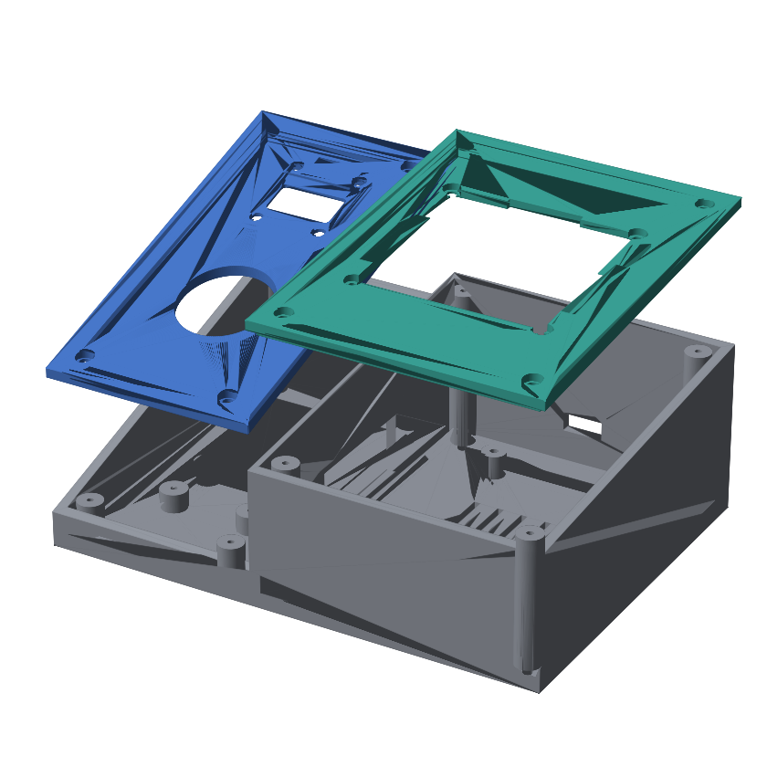
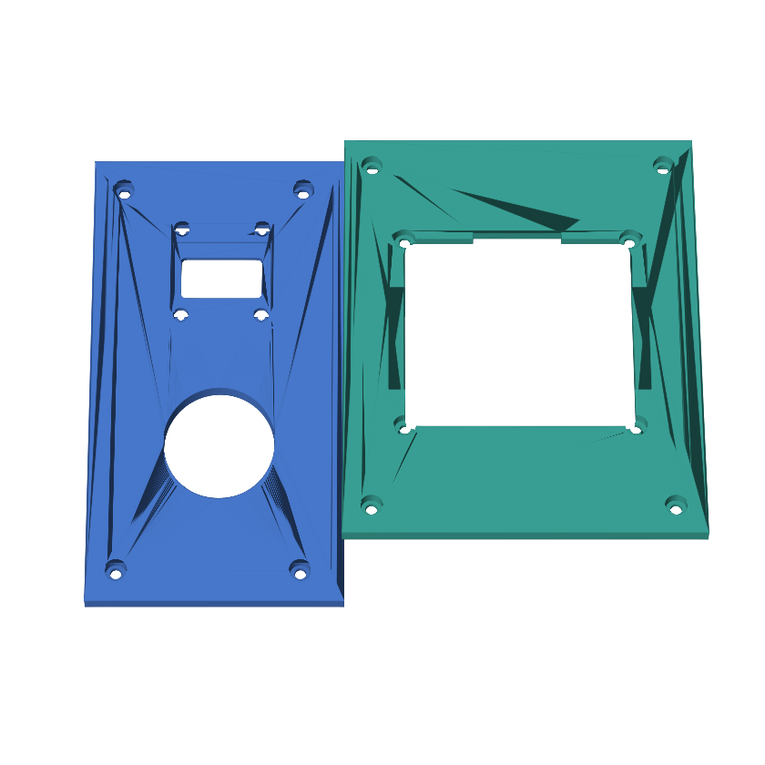

# Enclosure

A 3D-printable case in three parts, modelled in [CadQuery](https://cadquery.readthedocs.io).

| Part | File | Holds |
|------|------|-------|
| Base | [`stl/base.stl`](stl/base.stl) | Electronics, with the USB-C opening |
| Left lid | [`stl/lid_left.stl`](stl/lid_left.stl) | Joystick opening with thumb relief, OLED window and pocket |
| Right lid | [`stl/lid_right.stl`](stl/lid_right.stl) | 4×4 keypad (Adafruit PID 3844 footprint) |

The model is [`enclosure.py`](enclosure.py); the STL files are its exports.

| Exploded view | Lids, top view |
|:---:|:---:|
|  |  |

## Regenerate or preview

```bash
pip install cadquery
python3 enclosure/enclosure.py --part all --format stl      # writes enclosure/stl/
python3 enclosure/enclosure.py --part lid_left --format step
python3 enclosure/enclosure.py --part all --viewer          # needs OCP CAD Viewer
python3 enclosure/enclosure.py --part all --viewer --watch  # re-run on save
python3 enclosure/tools/render_stl.py                       # refresh the README renders (matplotlib)
```

## OLED mount

The left lid is dimensioned for a 128×64 SSD1315 module:

| Measure | Value |
|---------|-------|
| PCB | 27.3 × 27.8 mm |
| Visible window | 22.2 × 11.3 mm |
| Bezel recess | 27.0 × 19.6 mm |
| Mounting hole pitch | 21.8 × 23.8 mm |

The module screws in from the top with nuts underneath.

## Before printing

The mounting hole pitch of the OLED and the keypad's mounting pattern differ
between module vendors. Measure your parts against the values above and print
the lids once as a test fit before the final print.

## License

The enclosure design is part of o3Chords and is licensed under
[CC BY-NC-SA 4.0](https://creativecommons.org/licenses/by-nc-sa/4.0/), like
the rest of the project: free to print and modify for non-commercial use, with
credit, and modified designs shared under the same licence.
